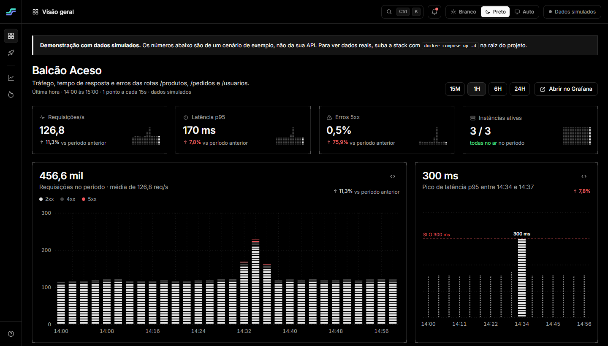
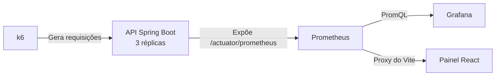
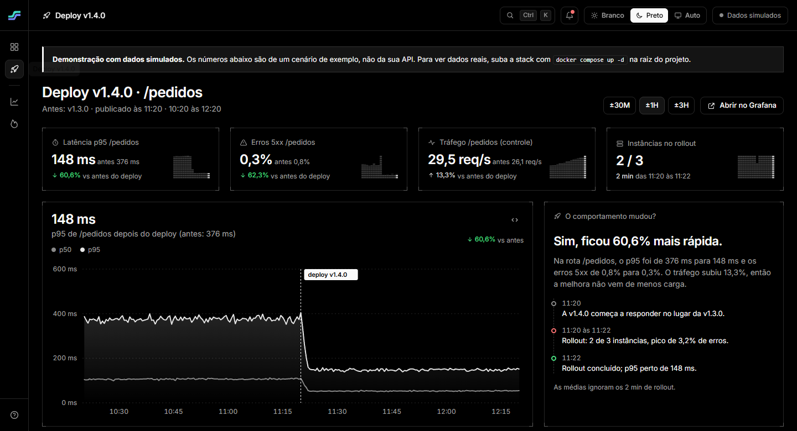

# Balcão Aceso

O Balcão Aceso é uma API de uma loja fictícia com rotas de produtos, pedidos e usuários. O projeto acompanha o que acontece quando o tráfego aumenta ou quando uma nova versão entra no ar. Dá para ver, por exemplo, se uma mudança em `/pedidos` reduziu o tempo de resposta e se a taxa de erros também mudou.



*A captura mostra o painel React em modo simulado.*

## Como as métricas chegam ao painel



| Componente | O que faz |
| --- | --- |
| **API Spring Boot** | Atende as rotas em Java 25 e devolve dados de exemplo mantidos em memória. O simulador introduz variações de latência e falhas para reproduzir o comportamento de uma loja sob carga. |
| **Actuator e Micrometer** | Medem a duração e o status HTTP das requisições. O endpoint `/actuator/prometheus` expõe os contadores e histogramas já com o rótulo `version`. |
| **Prometheus** | Descobre as três réplicas pelo DNS do Docker, coleta as métricas a cada 15 segundos e guarda até sete dias de histórico. |
| **Grafana** | Lê o Prometheus e carrega dois dashboards automaticamente. **Balcão Aceso** traz a visão geral e **Deploy · /pedidos** acompanha a rota durante uma troca de versão. |
| **k6** | Gera chamadas para as três rotas. Com a configuração padrão, a carga base soma 60 requisições por segundo e chega a 120 no fim de cada ciclo de 15 minutos. |
| **React e Vite** | Exibem a visão geral e a comparação de deploy. O painel aceita dados do Prometheus e tem um cenário simulado para demonstração. |

## Como rodar

### API, Prometheus, Grafana e k6

Com o Docker Compose disponível, execute na raiz do repositório.

```bash
docker compose up -d --build
docker compose ps
```

| Serviço | Acesso local |
| --- | --- |
| API | [Réplica 1](http://localhost:8081/actuator/health), [réplica 2](http://localhost:8082/actuator/health) e [réplica 3](http://localhost:8083/actuator/health) |
| Prometheus | [Consultas](http://localhost:9090/graph) e [alvos de coleta](http://localhost:9090/targets) |
| Grafana | [Balcão Aceso](http://localhost:3000/d/api-spring-boot) e [Deploy · /pedidos](http://localhost:3000/d/deploy-pedidos) |

O Grafana abre em modo de leitura sem login. A conta `admin` usa `GRAFANA_ADMIN_PASSWORD`, que vale `admin` por padrão no ambiente local. Aguarde algumas coletas para os gráficos de tráfego aparecerem.

Os padrões já estão no Compose. Para personalizar a execução, copie o arquivo [`.env.example`](.env.example) para `.env` e ajuste os valores.

| Variável | Padrão | Efeito |
| --- | --- | --- |
| `APP_VERSION` | `v1.4.0` | Valor do rótulo `version` nas métricas da API. |
| `PEDIDOS_CONSULTA_OTIMIZADA` | `true` | Com `false`, a rota `/pedidos` ganha o atraso extra da versão antiga. |
| `APP_CAPACIDADE_RPS` | `30` | Capacidade simulada de cada réplica em requisições por segundo. |
| `RPS_BASE` | `60` | Tráfego base total gerado pelo k6. |
| `GRAFANA_ADMIN_PASSWORD` | `admin` | Senha da conta local de administração do Grafana. |

Para encerrar, use `docker compose down`. O histórico do Prometheus e os dados do Grafana ficam nos volumes.

### Painel React

Com Node.js 22.12 ou posterior, execute os comandos na raiz.

```bash
cd "Dashboard/Dashboard grafana e prometheus"
npm ci
npm run dev
```

Abra [o painel no navegador](http://localhost:5173). Na fonte **Automática**, ele usa o Prometheus quando a conexão está disponível e passa para **Simulado** quando o serviço está fora do ar. O seletor no topo também permite escolher a fonte manualmente.

O Vite encaminha as consultas de `/prometheus` para `http://localhost:9090` durante `npm run dev` e `npm run preview`. Para apontar o proxy a outro servidor, adicione `PROMETHEUS_URL` ao `.env.local` do painel. Para uma publicação estática, configure o encaminhamento de `/prometheus` na hospedagem para mostrar dados ao vivo.

As variáveis `VITE_PROMETHEUS_URL` e `VITE_GRAFANA_URL` configuram os links exibidos no painel. `VITE_RESPONSAVEL` e `VITE_CONTATO` preenchem a identificação da instalação na política de privacidade e nos termos de uso.

## Rotas da API

Os pedidos, produtos e usuários abaixo são registros de exemplo. Todas as rotas são de leitura.

| Rota | O que retorna |
| --- | --- |
| `GET /produtos` | Catálogo com `id`, `nome`, `categoria` e `preco`. Aceita `?categoria=perifericos`, `monitores` ou `audio`. Uma categoria desconhecida retorna HTTP 400. |
| `GET /pedidos` | Pedidos com `id`, `produtoId`, `quantidade` e `status`. É a rota usada para comparar a versão lenta e a otimizada. |
| `GET /usuarios` | Usuários fictícios com `id` e `nome`. |
| `GET /actuator/health` | Estado da instância, usado também pelo Docker para checar a saúde do serviço. |
| `GET /actuator/info` | Informações de aplicação quando configuradas. |
| `GET /actuator/prometheus` | Métricas em texto para o Prometheus coletar. |

Teste a própria API pela primeira réplica. No Windows PowerShell, use `curl.exe` no lugar de `curl` se o comando estiver associado a um alias.

```bash
curl http://localhost:8081/actuator/health
curl "http://localhost:8081/produtos?categoria=perifericos"
curl http://localhost:8081/pedidos
curl http://localhost:8081/usuarios
```

## Como ler os indicadores

| Indicador | O que significa |
| --- | --- |
| **Requisições/s** | Ritmo de chamadas atendidas pelas réplicas. O detalhamento por rota mostra onde o tráfego se concentra. |
| **Latência p50 e p95** | Tempo em que cerca de 50% ou 95% das chamadas terminam. O p95 ajuda a enxergar as respostas lentas que a mediana esconde. |
| **Erros 5xx (%)** | Parcela das chamadas que falharam no servidor. O simulador pode retornar HTTP 500 ocasionalmente ou HTTP 503 quando a instância está saturada. |
| **Respostas por status** | Separa sucessos (2xx), erros do cliente (4xx) e erros do servidor (5xx). |
| **Instâncias ativas** | Quantas réplicas o Prometheus conseguiu coletar. A série `up` informa se a coleta funcionou em cada alvo. |
| **Limite de 300 ms** | Referência de latência do painel. A distribuição por faixas mostra quantas chamadas ficaram acima ou abaixo do limite. |

O painel React também sinaliza períodos de latência alta, erros ou queda de instâncias. Para inspecionar a consulta de um gráfico, use o botão `</>`. A busca com `Ctrl+K` ou `⌘K` dá acesso à exportação CSV do período da visão geral.

Por exemplo, a consulta abaixo soma o ritmo das requisições das três réplicas nos últimos cinco minutos, excluindo as chamadas de monitoramento.

```promql
sum(rate(http_server_requests_seconds_count{job="api-spring-boot", uri!~"/actuator.*"}[5m]))
```

## Experimento de deploy em `/pedidos`



*A captura usa o cenário simulado. O marcador indica quando aparece a nova versão.*

1. No `.env`, configure `APP_VERSION=v1.3.0` e `PEDIDOS_CONSULTA_OTIMIZADA=false`. Suba a stack com `docker compose up -d --build`.
2. Aguarde cerca de 15 minutos para coletar dados da versão antiga.
3. Troque para `APP_VERSION=v1.4.0` e `PEDIDOS_CONSULTA_OTIMIZADA=true`. Recrie as réplicas com `docker compose up -d api`.
4. Aguarde alguns minutos e abra **Deploy · /pedidos** no Grafana ou a tela de deploy no painel React. Compare p95, taxa de erros e volume de tráfego antes e depois da mudança.

A diferença entre as versões vem do atraso extra simulado em `/pedidos`. As telas usam o rótulo `version` para marcar a troca. No painel React, a comparação separa a janela de troca das médias de antes e depois.

## Onde fica cada parte

| Caminho | Conteúdo |
| --- | --- |
| [`api/`](api/) | Controller das rotas, simulador de carga e configuração do Actuator e do Micrometer. |
| [`prometheus/`](prometheus/) | Intervalo de coleta e descoberta das réplicas. |
| [`grafana/`](grafana/) | Dashboards provisionados e conexão com o Prometheus. |
| [`carga/carga.js`](carga/carga.js) | Distribuição das chamadas por rota e ciclos de carga do k6. |
| [`Dashboard/`](Dashboard/Dashboard%20grafana%20e%20prometheus/) | Código e documentação do painel React. |
| [`docker-compose.yml`](docker-compose.yml) | Serviços, portas, configurações e volumes da execução local. |
