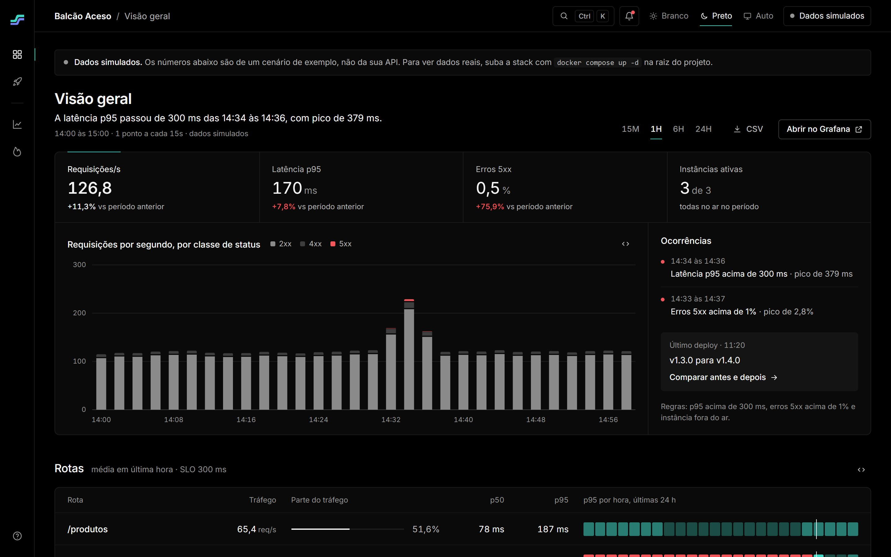
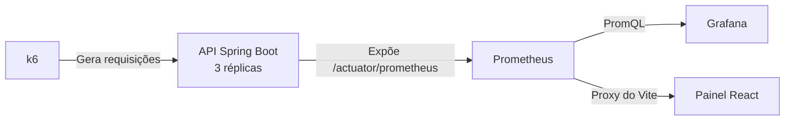
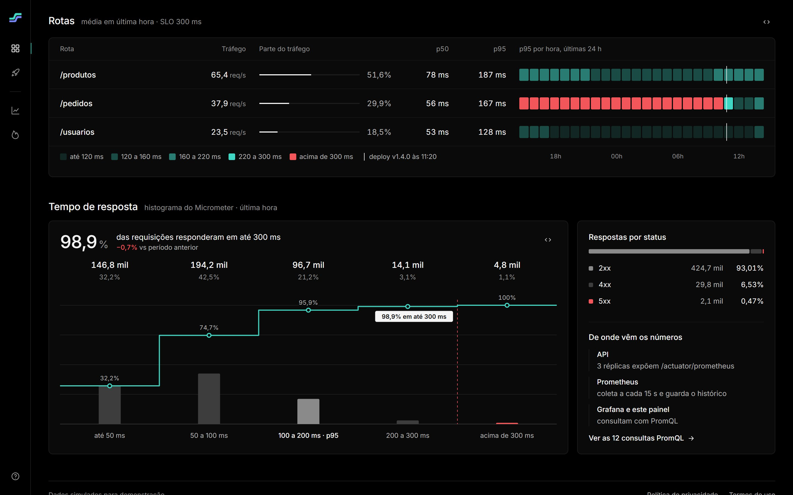
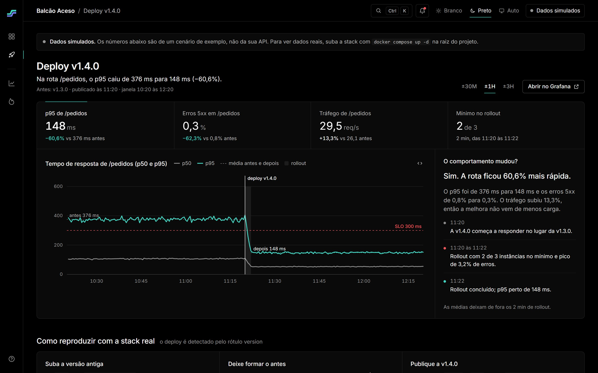
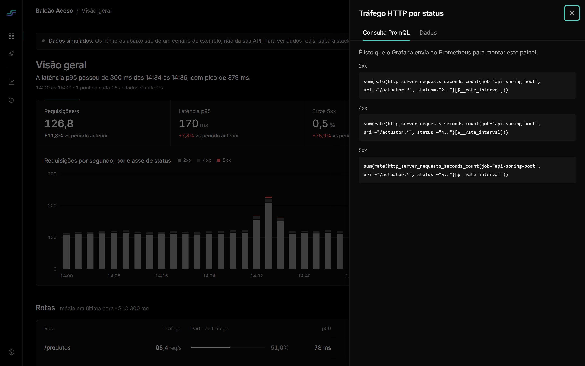
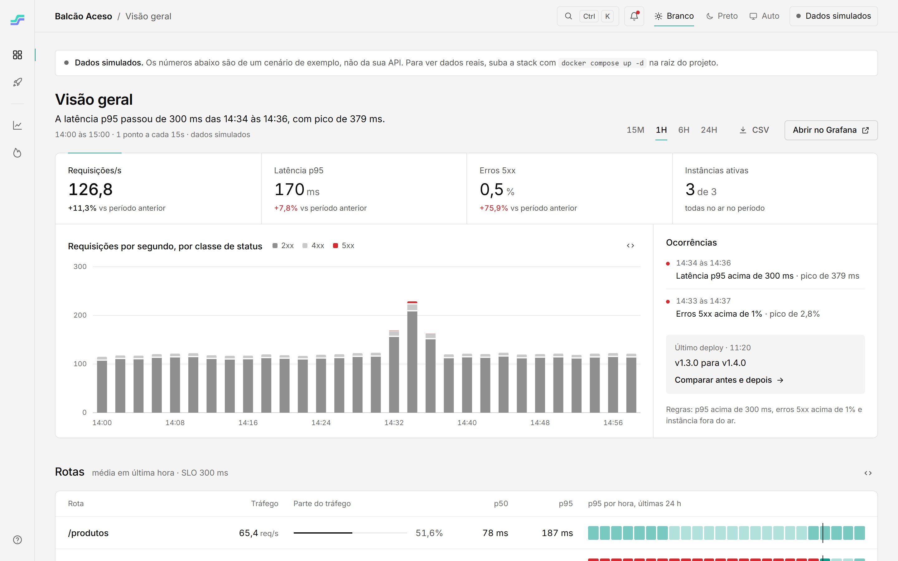
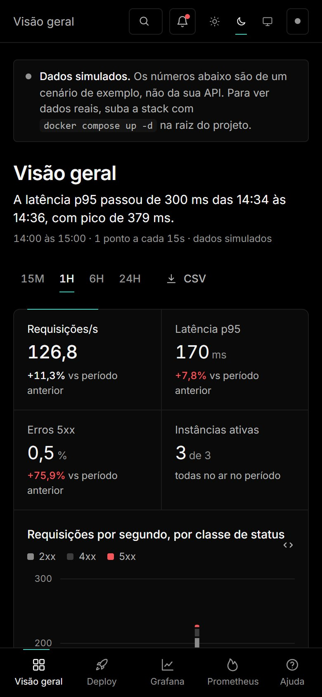

# Balcão Aceso

O Balcão Aceso é uma API de uma loja fictícia com rotas de produtos, pedidos e usuários. O projeto acompanha o que acontece quando o tráfego aumenta ou quando uma nova versão entra no ar. Dá para ver, por exemplo, se uma mudança em `/pedidos` reduziu o tempo de resposta e se a taxa de erros também mudou.



*Painel React em modo simulado. Mais fotos, com o que cada parte mostra, em [O painel em fotos](#o-painel-em-fotos).*

## Como as métricas chegam ao painel



| Componente | O que faz |
| --- | --- |
| **API Spring Boot** | Atende as rotas em Java 25 e devolve dados de exemplo mantidos em memória. O simulador introduz variações de latência e falhas para reproduzir o comportamento de uma loja sob carga. |
| **Actuator e Micrometer** | Medem a duração e o status HTTP das requisições. O endpoint `/actuator/prometheus` expõe os contadores e histogramas já com o rótulo `version`. |
| **Prometheus** | Descobre as três réplicas pelo DNS do Docker, coleta as métricas a cada 15 segundos e guarda até sete dias de histórico. |
| **Grafana** | Lê o Prometheus e carrega dois dashboards automaticamente. **Balcão Aceso** traz a visão geral e **Deploy · /pedidos** acompanha a rota durante uma troca de versão. |
| **k6** | Gera chamadas para as três rotas. Com a configuração padrão, a carga base soma 60 requisições por segundo e chega a 120 no fim de cada ciclo de 15 minutos. |
| **React e Vite** | Exibem a visão geral e a comparação de deploy. O painel aceita dados do Prometheus e tem um cenário simulado para demonstração. |

## Como rodar

### API, Prometheus, Grafana e k6

Com o Docker Compose disponível, execute na raiz do repositório.

```bash
docker compose up -d --build
docker compose ps
```

| Serviço | Acesso local |
| --- | --- |
| API | [Réplica 1](http://localhost:8081/actuator/health), [réplica 2](http://localhost:8082/actuator/health) e [réplica 3](http://localhost:8083/actuator/health) |
| Prometheus | [Consultas](http://localhost:9090/graph) e [alvos de coleta](http://localhost:9090/targets) |
| Grafana | [Balcão Aceso](http://localhost:3000/d/api-spring-boot) e [Deploy · /pedidos](http://localhost:3000/d/deploy-pedidos) |

O Grafana abre em modo de leitura sem login. A conta `admin` usa `GRAFANA_ADMIN_PASSWORD`, que vale `admin` por padrão no ambiente local. Aguarde algumas coletas para os gráficos de tráfego aparecerem.

Os padrões já estão no Compose. Para personalizar a execução, copie o arquivo [`.env.example`](.env.example) para `.env` e ajuste os valores.

| Variável | Padrão | Efeito |
| --- | --- | --- |
| `APP_VERSION` | `v1.4.0` | Valor do rótulo `version` nas métricas da API. |
| `PEDIDOS_CONSULTA_OTIMIZADA` | `true` | Com `false`, a rota `/pedidos` ganha o atraso extra da versão antiga. |
| `APP_CAPACIDADE_RPS` | `30` | Capacidade simulada de cada réplica em requisições por segundo. |
| `RPS_BASE` | `60` | Tráfego base total gerado pelo k6. |
| `GRAFANA_ADMIN_PASSWORD` | `admin` | Senha da conta local de administração do Grafana. |

Para encerrar, use `docker compose down`. O histórico do Prometheus e os dados do Grafana ficam nos volumes.

### Painel React

Com Node.js 22.12 ou posterior, execute os comandos na raiz.

```bash
cd "Dashboard/Dashboard grafana e prometheus"
npm ci
npm run dev
```

Abra [o painel no navegador](http://localhost:5173). Na fonte **Automática**, ele usa o Prometheus quando a conexão está disponível e passa para **Simulado** quando o serviço está fora do ar. O seletor no topo também permite escolher a fonte manualmente.

Cada gráfico se monta quando aparece na tela ao rolar para baixo: as colunas crescem da base, as linhas avançam no ritmo do eixo do tempo e a faixa de 24 horas acende hora a hora. Se o sistema pedir menos movimento (por exemplo, com as animações do Windows desligadas), os gráficos só esmaecem. Para mudar isso, abra a busca com `Ctrl+K` e escolha **Animação: completa** ou **Animação: desligada**.

O Vite encaminha as consultas de `/prometheus` para `http://localhost:9090` durante `npm run dev` e `npm run preview`. Para apontar o proxy a outro servidor, adicione `PROMETHEUS_URL` ao `.env.local` do painel. Para uma publicação estática, configure o encaminhamento de `/prometheus` na hospedagem para mostrar dados ao vivo.

As variáveis `VITE_PROMETHEUS_URL` e `VITE_GRAFANA_URL` configuram os links exibidos no painel. `VITE_RESPONSAVEL` e `VITE_CONTATO` preenchem a identificação da instalação na política de privacidade e nos termos de uso.

## Rotas da API

Os pedidos, produtos e usuários abaixo são registros de exemplo. Todas as rotas são de leitura.

| Rota | O que retorna |
| --- | --- |
| `GET /produtos` | Catálogo com `id`, `nome`, `categoria` e `preco`. Aceita `?categoria=perifericos`, `monitores` ou `audio`. Uma categoria desconhecida retorna HTTP 400. |
| `GET /pedidos` | Pedidos com `id`, `produtoId`, `quantidade` e `status`. É a rota usada para comparar a versão lenta e a otimizada. |
| `GET /usuarios` | Usuários fictícios com `id` e `nome`. |
| `GET /actuator/health` | Estado da instância, usado também pelo Docker para checar a saúde do serviço. |
| `GET /actuator/info` | Informações de aplicação quando configuradas. |
| `GET /actuator/prometheus` | Métricas em texto para o Prometheus coletar. |

Teste a própria API pela primeira réplica. No Windows PowerShell, use `curl.exe` no lugar de `curl` se o comando estiver associado a um alias.

```bash
curl http://localhost:8081/actuator/health
curl "http://localhost:8081/produtos?categoria=perifericos"
curl http://localhost:8081/pedidos
curl http://localhost:8081/usuarios
```

## Como ler os indicadores

| Indicador | O que significa |
| --- | --- |
| **Requisições/s** | Ritmo de chamadas atendidas pelas réplicas. O detalhamento por rota mostra onde o tráfego se concentra. |
| **Latência p50 e p95** | Tempo em que cerca de 50% ou 95% das chamadas terminam. O p95 ajuda a enxergar as respostas lentas que a mediana esconde. |
| **Erros 5xx (%)** | Parcela das chamadas que falharam no servidor. O simulador pode retornar HTTP 500 ocasionalmente ou HTTP 503 quando a instância está saturada. |
| **Respostas por status** | Separa sucessos (2xx), erros do cliente (4xx) e erros do servidor (5xx). |
| **Instâncias ativas** | Quantas réplicas o Prometheus conseguiu coletar. A série `up` informa se a coleta funcionou em cada alvo. |
| **Limite de 300 ms** | Referência de latência do painel. A distribuição por faixas mostra quantas chamadas ficaram acima ou abaixo do limite. |

O painel React também sinaliza períodos de latência alta, erros ou queda de instâncias. Para inspecionar a consulta de um gráfico, use o botão `</>`. A busca com `Ctrl+K` ou `⌘K` dá acesso à exportação CSV do período da visão geral.

Por exemplo, a consulta abaixo soma o ritmo das requisições das três réplicas nos últimos cinco minutos, excluindo as chamadas de monitoramento.

```promql
sum(rate(http_server_requests_seconds_count{job="api-spring-boot", uri!~"/actuator.*"}[5m]))
```

## O painel em fotos

Todas as fotos foram tiradas com a fonte **Simulado**, então os números são do cenário de exemplo, e não de uma API rodando de verdade. Com a stack no ar, as mesmas telas mostram o Prometheus ao vivo.

### Visão geral


É a primeira tela. Embaixo do título fica uma frase com o que mais pede atenção no período escolhido; aqui, a latência p95 que passou de 300 ms entre 14:34 e 14:36. Os quatro números do topo (requisições/s, latência p95, erros 5xx e instâncias ativas) também funcionam como abas: clicar num deles troca o gráfico de baixo. A aba escolhida ganha um traço teal fino em cima do nome, o mesmo traço que marca o período (15M, 1H, 6H, 24H) e o item ativo do menu lateral.

Ao lado do gráfico, **Ocorrências** lista as regras que dispararam no período, com horário e pico, e o último deploy, com um atalho para a comparação de antes e depois.

### Rotas e tempo de resposta



A tabela **Rotas** mostra o tráfego, a parte de cada rota, o p50 e o p95. A última coluna tem 24 quadradinhos, um por hora, coloridos pelo p95 daquela hora: quanto mais forte o teal, mais lenta a rota, e vermelho é acima de 300 ms. O traço vertical marca o deploy. Dá para ver a história do projeto numa linha só: `/pedidos` passa o dia no vermelho e volta para o teal na hora das 11:20, quando a v1.4.0 entra.

Em **Tempo de resposta**, as barras vêm direto dos buckets do histograma do Micrometer (até 50 ms, 50 a 100, 100 a 200, 200 a 300 e acima de 300). A escada teal soma as faixas da esquerda para a direita, e a etiqueta mostra onde ela cruza o limite de 300 ms: 98,9% das requisições responderam a tempo. Ao lado ficam a divisão das respostas por status e de onde vêm os números.

### Antes e depois do deploy



Compara a rota `/pedidos` antes e depois da troca de versão. Cada número do topo traz o valor depois do deploy e quanto mudou em relação ao antes. O gráfico desenha a média de cada lado como uma linha tracejada, então a queda de 376 ms para 148 ms aparece sem precisar fazer conta. A coluna da direita responde a pergunta da tela ("O comportamento mudou?") e mostra a linha do tempo do rollout. O tráfego entra como controle: se ele tivesse caído, a melhora poderia ser só menos carga.

### A consulta por trás de cada gráfico



Todo gráfico tem um botão `</>`. Ele abre uma gaveta com a consulta PromQL exata que o Grafana e o painel mandam para o Prometheus, e uma aba **Dados** com a tabela dos pontos desenhados. Serve para conferir um número ou copiar a consulta para o Grafana.

### Fundo branco



O fundo padrão é preto, mas o seletor no topo troca para branco ou segue o tema do sistema (**Auto**). As cores têm os mesmos papéis nos dois: cinza para a estrutura, teal para o dado principal e vermelho só para erro e para o limite de 300 ms. A escolha fica salva no navegador.

### No celular



No celular, o menu lateral vira uma barra embaixo, os quatro números ficam em duas colunas e cada rota da tabela vira um bloco de duas linhas, sem perder nenhuma coluna.

## Experimento de deploy em `/pedidos`


*Cenário simulado. A linha vertical marca a entrada da v1.4.0; a faixa cinza logo depois é o rollout.*

1. No `.env`, configure `APP_VERSION=v1.3.0` e `PEDIDOS_CONSULTA_OTIMIZADA=false`. Suba a stack com `docker compose up -d --build`.
2. Aguarde cerca de 15 minutos para coletar dados da versão antiga.
3. Troque para `APP_VERSION=v1.4.0` e `PEDIDOS_CONSULTA_OTIMIZADA=true`. Recrie as réplicas com `docker compose up -d api`.
4. Aguarde alguns minutos e abra **Deploy · /pedidos** no Grafana ou a tela de deploy no painel React. Compare p95, taxa de erros e volume de tráfego antes e depois da mudança.

A diferença entre as versões vem do atraso extra simulado em `/pedidos`. As telas usam o rótulo `version` para marcar a troca. No painel React, a comparação separa a janela de troca das médias de antes e depois.

## Onde fica cada parte

| Caminho | Conteúdo |
| --- | --- |
| [`api/`](api/) | Controller das rotas, simulador de carga e configuração do Actuator e do Micrometer. |
| [`prometheus/`](prometheus/) | Intervalo de coleta e descoberta das réplicas. |
| [`grafana/`](grafana/) | Dashboards provisionados e conexão com o Prometheus. |
| [`carga/carga.js`](carga/carga.js) | Distribuição das chamadas por rota e ciclos de carga do k6. |
| [`Dashboard/`](Dashboard/Dashboard%20grafana%20e%20prometheus/) | Código e documentação do painel React. |
| [`docker-compose.yml`](docker-compose.yml) | Serviços, portas, configurações e volumes da execução local. |
